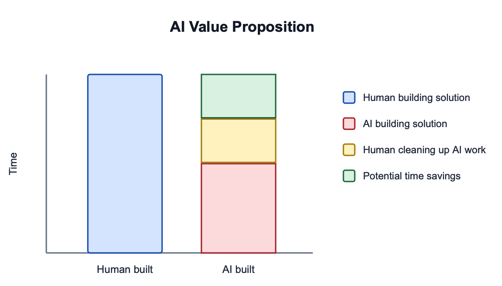

# Recommendations for software professionals in the age of AI

#### Date published: 2026-11-01

## Why did I write this?

I keep feeling lost about all this AI stuff, and I kept feeling the need for someone knowledgeable to have a take on AI and explain it to me. Like, ideally someone that's a professional software engineer, maybe with a degree in the field, with many years of experience, at least 10-15. And then much to my chagrin I realize I'm describing myself. I'm exactly the kind person I would want to have a take on AI, so I felt compelled to organize my thoughts and share them with you.

## The vibes are off

I have lots of unanswered questions about AI. First and foremost: what problem is AI solving? Without defining that, there's no way to evaluate how effective it is. More importantly, the usual way to evaulate new technology is to define the problem, define the criteria of the solution, and then evaulate technologies for how well they solve the problem by meeting the criteria of the solution. Why did we abandon this process for AI? What is the feature set of AI? What does it excel at and what is it bad at? How are we supposed to use this new technology? Rather than even attempting to answer to answer these questions, all anyone seems to focus on with AI is one particular aspect: speed.

## What is the value proposition of AI?

All the dialogue and news headlines and anecdotes and buzz about AI successes are focused solely on the speed at which source code, technical docs, and prose (hereafter collectively called artifacts) are produced. The majority of AI users are trying to integrate AI into their daily workflows with the hope that it will enable them to get their work done faster. The implicit value proposition is that AI is a tool that enables you to trade quality for speed.

Speed isn't even the correct thing to optimize for. What we're really trying to optimize when we talk about "moving faster" isn't speed, it's efficiency. Efficiency is the combination of speed and accuracy. Taking too long to produce a correct solution isn't efficient; likewise, quickly producing an incorrect solution is also inefficient. Speed is only half the equation here. Why aren't we loudly talking about how we're using AI to make our software more correct, more robust, and higher quality? We're focusing on the wrong things because we're [anchored](https://en.wikipedia.org/wiki/Anchoring_effect) by what AI already does well.

From my own firsthand experience plus conversations with other software professionals about their firsthand experience, I've concluded that AI excels at producing a large volume of low quality artifacts very quickly. Since the quality of artifacts produced by AI is lower than those produced by a human, it's expected for us to spend some time editing or cleaning up AI artifacts to improve their quality until we consider them to be "good enough". The hope is that the time we spend on editing/cleanup to bring the quality up to "good enough" is less than the time we saved by having AI do the work instead of us.

This creates a problematic dynamic where the work is "done" for some defintion of done and it's then left to individual discretion to decide how long to spend on editing/cleanup and what "good enough" means. Given that we're all busy professionals, I don't need to tell you that the result of this is a flexible defintion of "good enough" and many corners being cut. This dynamic has further been complicated by implicit changes to our shared social contract. If I were to put that into words it would be: "it's now fashionable to experiment with shipping lower-quality work, as long as it was created quickly by AI". I'm not sure why people are adjusting their standards based on the provenance of the artifact.

## Why quality is important

Quality is not something you tack on at the end of a task or project, like a coat of paint. It's an emergent property of a system that results from the time and care a human spends designing and building that system. It's not one thing you can point at; it's a combination of tangible and intangible properties that combine to form something greater than the sum of its parts. I have more to say on this topic, but I believe that the simplest and most reliable way to lower the cost of building software systems on any timescale is to focus on building high-quality artifacts. High quality code is easier to read, understand, and change. High quality documentation makes it easier to understand how a system works and why it works that way. Quality is the best way to lower your long-term software development costs, in both time and money.

Lest you think I'm merely stating my opinion, let me direct you to some scientific studies on the impact of quality in software. A 2022 study of [the business impact of code quality](https://dl.acm.org/doi/epdf/10.1145/3524843.3528091) found that low quality code contained 15 times more defects than high quality code and those defects took more than twice as long to fix. A 2019 study examining [productivity loss due to technical debt](https://www.sciencedirect.com/science/article/abs/pii/S0164121219301335) found that on average, technical debt wastes 23% of a developer's time. When technical debt is encountered, there's a 25% chance that the developer will create additional technical debt as a result. A 2024 study of [the returns of highly maintainable code](https://dl.acm.org/doi/epdf/10.1145/3644384.3644471) found that quality differences towards the extremes produced non-linear results. In other words, the incremental effort going from good quality to great quality produces an outsized improvement in decreasing defect count and development time. A 2022 study titled [What improves developer productivity at Google? Code quality](https://dl.acm.org/doi/10.1145/3540250.3558940) examined which factors influence developer productivity. They found that the two biggest factors were the developers' satisfaction with both code quality and infrastructure and tooling. They also found evidence that improvements in code quality caused improvements in developer productivity.

All these studies confirm my experience that trading quality for speed is a false tradeoff. By this I don't mean I'm making a judgement and saying you shouldn't do this, I mean that choosing to accept lower quality software doesn't actually make you go faster.

One approach to the quality problem is to turn hard in the other direction: instead of trying to edit/cleanup AI artifacts, what if we just give up not only on writing code but on reading it as well? I understand the appeal; code that was written by someone or something else is much harder to understand than code you wrote yourself. This is because having a mental model of the system you're trying to build is a prerequisite for writing the code yourself. When you read code someone or something else wrote, you have to build that mental model from scratch. This is more difficult and takes more time and effort because you're coming at the solution from the outside. AI has created a novel situation where it's now possible to produce working software without understanding it. Some people in our industry are [celebrating](https://www.globalnerdy.com/2026/09/27/dhhs-keynote-at-rails-world-2026-the-most-confusing-funeral-ive-ever-experienced/) this, others are [mourning](https://www.ivanturkovic.com/2026/01/23/code-is-for-humans-not-machines-why-ai-wont-make-syntax-obsolete/) it.

## Everything old is new again

In 1985, Peter Naur published an important article titled [Programming as Theory Building](https://gwern.net/doc/cs/algorithm/1985-naur.pdf). You should absolutely read the whole thing as it's only 12 pages. In it, Naur lays out his thesis that a program is more than the sum of its tangible artifacts. He challenges the common view that programming is mostly about manipulating text and instead asserts that programming is primarily about building a "theory of the program" -- what we would today call a mental model. This explains why the original author of a piece of code is able to modify it so quickly and easily and why without the original author, code quickly devolves into a complex and confusing mess. The systems we build are not purely technical. Since they include both the users of the system as well as the people who built it, these are sociotechnical systems.

Since we are part of the systems we build, we _must_ participate by building mental models of these systems. If you generate code with AI and don't bother to build a mental model of what it produced, you're skipping a crucial step of building software systems. Not only is this mental model important, it's the most important outcome of the whole process. If you are using AI to generate code that you don't understand, you're not developing software you're speedrunning tech debt. Doubly so if you choose not to review AI-generated code.

## A call to action

All this AI stuff has gotten me thinking about the 3 laws of robotics, coined by renowed science fiction author Isaac Asimov. I believe we need some rules (or laws) about how to thrive in the age of AI. Since the laws of robotics were for robots, laws for humans would be called laws of humanity. Here I present my first law:

> First Law of Humanity: You must understand the software systems you build

I'm shocked that anyone is taking seriously the idea that it's acceptable to not read and understand AI-generated code. No technological advancement has ever or will ever remove the need for the people building software systems to understand how those systems work. Software is the most complex thing that humans build. Just because understanding has become the bottleneck doesn't mean it's ethically justified to experiment with skipping it entirely.

## The paradox at the heart of AI

I originally made an effort when discussing AI to point out that AI is just a tool. I feel differently about that now. A tool is something that a human uses to assist them in completing a task. AIs can run on their own with little prompting; they're not tools but machines. But what are these machines designed to do?

We now have this amazing technology that is powerful enough to fill in the blanks for us when we specify tasks to be completed. I would go as far as to say this new technology is sufficiently advanced to be considered [magical](https://en.wikipedia.org/wiki/Clarke%27s_three_laws). However, if something external to us is making those decisions of what to fill in those blanks, then of course we're not the ones doing it. Since making decisions requires thinking, if we're no longer making those decisions, that means that we're no longer doing the thinking. We have our answer for what these machines are designed to do: replace human thinking. If this sounds extreme to you, it's right there in the name. Artificial intelligence. These machines are designed with the intent to replace your thinking.

We now live in a world where novices and professional software developers alike can produce working software systems without understanding them and without doing the work of thinking. Just because you can do something, doesn't necessarily mean that you should. That's why I propose the next law:

> Second Law of Humanity: You must not delegate your thinking to the machine

The practice of reflecting on your own thoughts and ideas develops the skills of self-awareness, discernment, critical thinking, and problem solving. These are the ingredients of being not only a good employee but also a good citizen. The cost of using an AI is more than monetary; delegating your work deprives you of learning and growing. That brings us to my final proposed law:

> Third Law of Humanity: You must use AI to improve your skills

The phrase deskilling has become commonly used to describe the process where by not using a skill, you get worse at it over time. Nobody I've heard has denied this is true, the entire discussion has been around how long it takes for skills to atrophy and that it's not such a bad thing to get worse at skills that don't matter. If you find anyone pushing back on you developing your own skills, consider that a red flag to look into. I don't feel comfortable using any technology in a way that slowly makes me worse at the skills I use to make a living.

## Parting thoughts

I'm surprised to see how many people have forgotten that AI is only software. Complex, novel, capable, interesting, even magical yes, but still only software. Software is made by humans for the purpose of serving humans. It has recently become fashionable to experiment with discarding long-held beliefs about building software systems. We've recently gotten very good at writing code that writes code, so good in fact that some people out there have begun experimenting with removing humans from the process entirely. I'm curious to see the results and I hope that at the end of this period of experimentation, we have an even stronger sense of what's important and why.
